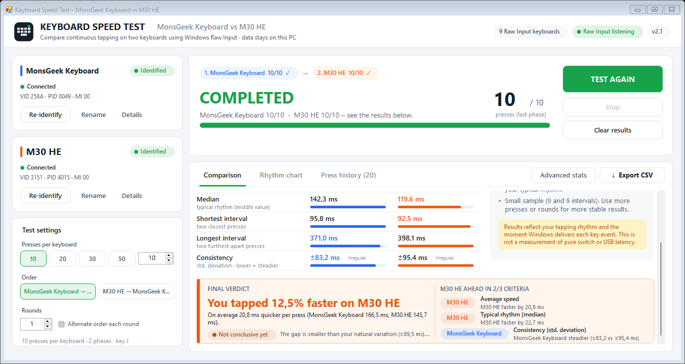
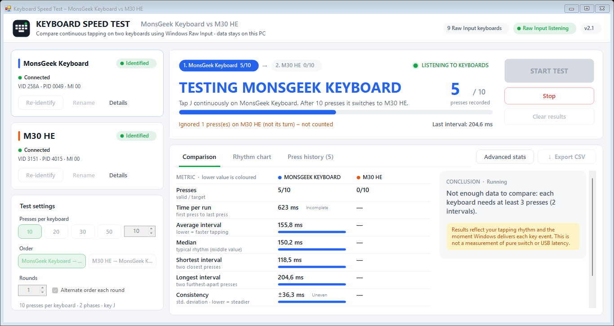
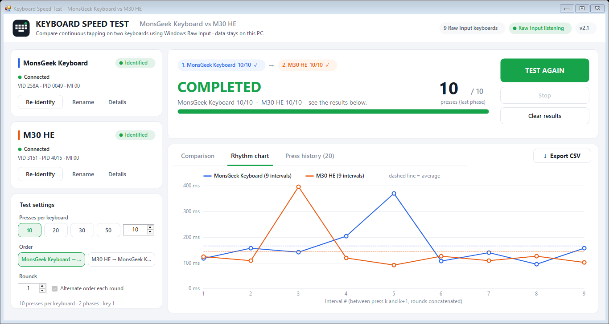

# Keyboard Speed Test – compare two keyboards side by side (Windows)

**Keyboard Speed Test** is a free, portable Windows app that lets you plug in **two keyboards at the same time** and compare how fast and how steadily you can tap on each one.
It reads every keyboard separately through the **Windows Raw Input API**, so it always knows which keyboard each key press came from. That makes it useful for comparing a mechanical keyboard with a Hall-effect / rapid-trigger keyboard, an old board with a new one, or two different switches.

🇻🇳 **Tiếng Việt:** xem [README.vi.md](README.vi.md). The app itself is available in **English and Vietnamese** (you choose at start-up).



---

## Features

- **Any two keyboards**: identify them with one key press each. The name is read from the keyboard's HID product string (e.g. "MonsGeek Keyboard") and can be renamed.
- **Continuous tap test, no waiting**: no countdown, no "wait for green" reaction cues. Tap `J` N times on keyboard A, and the app switches to keyboard B the instant A is done.
- **Accurate per-device capture**: Raw Input runs on its own high-priority thread. Each event is timestamped with `Stopwatch` (monotonic, high resolution) the moment `WM_INPUT` arrives.
- **Fair counting**: auto-repeat from holding a key is ignored (a press only counts after its KeyUp). Presses on the wrong keyboard are flagged but never counted, and they don't interrupt the test.
- **Clear statistics**: presses, time per run, average / median / shortest / longest interval, and consistency (standard deviation), with a plain-language explanation of each.
- **Final verdict**: who you tapped faster on, by how many % and ms, how many criteria each keyboard wins, and whether the gap is a **clear difference** or **not conclusive yet** (95% confidence interval, with a suggested number of presses to confirm).
- **Charts and history**: an interval chart and a full press log you can filter by keyboard or show ignored presses only.
- **CSV export**: settings, devices, summary, verdict, method notes, every valid press and the raw event log. UTF-8 with BOM, using your Windows list/decimal separators so Excel opens it correctly.
- Presses per keyboard 10/20/30/50/custom, choice of order, multiple rounds with alternating order.
- Remembers your keyboards and their names, and re-identifies them automatically after unplugging and replugging.
- Portable: no installer, no admin rights, no internet, no telemetry. All data stays on your PC.

| Testing | Rhythm chart |
|---|---|
|  |  |

---

## Download and run

Requirements: **Windows 10 or 11** (Windows PowerShell 5.1 and .NET Framework 4.x are built in, nothing to install).

1. Click **Code → Download ZIP** on this page and extract the whole folder (keep the `src` folder).
2. Plug in both keyboards.
3. Double-click **`Run_KeyboardSpeedTest.bat`** (Vietnamese name: `Chay_KeyboardSpeedTest.bat`, same file).
4. Choose **English** or **Tiếng Việt**.

Optional: build a standalone `KeyboardSpeedTest.exe` from the same sources (uses the C# compiler that ships with Windows):

```powershell
powershell -ExecutionPolicy Bypass -File tools\Build.ps1
```

## How to test

1. On card **A** click **Identify**, then press `J` on your first keyboard. Do the same on card **B** with the second keyboard.
2. Pick the number of presses (default 10), the order and the number of rounds.
3. Click **START TEST** and tap `J` continuously on the keyboard shown in the big panel. The counter updates on every press.
4. When keyboard A reaches the target, keep tapping on keyboard B. When B is done, the results and the final verdict appear immediately.
5. Click **Export CSV** to save the data.

Tips: run 30–50 presses per keyboard, or several rounds with *Alternate order* enabled, so the result doesn't depend on getting warmed up.

## What the numbers mean

An **interval** is the time between two consecutive presses on the **same** keyboard. 10 presses give 9 intervals. The switch-over from one keyboard to the other is never counted.

| Metric | Meaning |
|---|---|
| Average interval | Lower = faster tapping |
| Median | Typical rhythm, robust to one long pause |
| Shortest / longest | Fastest and slowest single interval |
| Consistency (SD) | Low = steady rhythm, high = some unusually fast or slow presses |
| Advanced | Tap rate (presses/s), coefficient of variation, P95 (only with ≥ 20 intervals), long pauses, out-of-turn presses |

## Is this a keyboard latency test?

**No, and the app says so.** The timestamps mark when Windows delivers each key event to the app, not when the switch physically actuates. The results show **your tapping rhythm on each keyboard** in real use, as received by Windows. The app never claims that one keyboard has "X ms lower hardware latency". Measuring true input latency requires dedicated hardware (e.g. a photodiode or logic analyser).

## How it works (technical)

- C# (WinForms, .NET Framework 4.x). Compiled at launch with PowerShell `Add-Type`, or built into an EXE with `csc.exe`. No third-party libraries.
- `RegisterRawInputDevices` (usage page 1, usage 6, `RIDEV_INPUTSINK | RIDEV_DEVNOTIFY`) on a message-only window running on a dedicated thread.
- Devices are told apart by `hDevice` and their device path (`RIDI_DEVICENAME`). Names come from `HidD_GetProductString`.
- Only the HID interface that sent the identifying key press is counted. A keyboard often exposes several interfaces (`MI_00`, `MI_01`…), and if a key arrives from a sibling interface the app tells you to re-identify using `J`.
- `src/Core.cs` has no UI dependency. `tests/Tests.cs` covers the filter, phase switching, intervals, statistics, verdict, CSV, both languages, the Raw Input pipeline (via `SendInput` on F24) and off-screen UI screenshots:

```powershell
powershell -ExecutionPolicy Bypass -File tools\Build.ps1 -Screens
```

## Project layout

```
Run_KeyboardSpeedTest.bat   start the app (English name)
Chay_KeyboardSpeedTest.bat  start the app (Vietnamese name)
KeyboardSpeedTest.ps1       launcher (compiles src\*.cs via Add-Type); -Lang en|vi skips the picker
src\Lang.cs                 Vietnamese / English strings helper
src\Core.cs                 test session, statistics, verdict, CSV
src\RawInput.cs             Raw Input thread, HID device info, saved devices
src\UiControls.cs           custom-drawn UI components
src\MainForm.cs             main window, language picker, rename dialog
tests\Tests.cs              automated tests
tools\Build.ps1             build EXE + run tests
```

Settings and identified keyboards are stored in `%LOCALAPPDATA%\KeyboardSpeedTest\` on your PC only.

## License

[MIT](LICENSE)

---

*Keywords: keyboard test, keyboard speed test, compare two keyboards, tap test, tapping speed, key press interval, keyboard benchmark, mechanical keyboard, Hall effect keyboard, rapid trigger, magnetic switch, Raw Input, multiple keyboards Windows, so sánh bàn phím, test bàn phím.*
