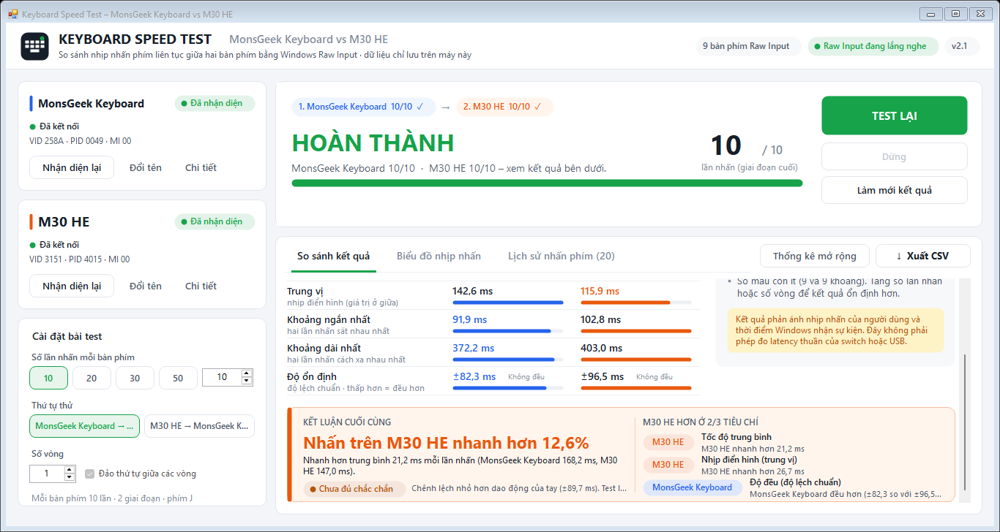

# Keyboard Speed Test – so sánh hai bàn phím (Windows)

**Keyboard Speed Test** là ứng dụng Windows miễn phí, chạy ngay không cần cài đặt. Bạn cắm **hai bàn phím cùng lúc**, tự tay nhấn phím trên từng bàn phím, và ứng dụng so sánh nhịp nhấn nhanh và đều đến mức nào trên mỗi bên.
Ứng dụng đọc từng bàn phím riêng biệt bằng **Windows Raw Input**, nên luôn biết mỗi lần nhấn đến từ bàn phím nào. Phù hợp để so sánh bàn phím cơ với bàn phím Hall-effect / rapid trigger, bàn phím cũ với bàn phím mới, hoặc hai loại switch.

🇬🇧 English: [README.md](README.md). Giao diện có **tiếng Việt và tiếng Anh**, chọn khi mở ứng dụng.



## Tính năng

- **Hai bàn phím bất kỳ**: nhận diện mỗi bàn phím bằng một lần nhấn phím. Tên được lấy tự động từ HID (ví dụ "MonsGeek Keyboard") và có thể đổi tên.
- **Nhấn liên tục, không chờ**: không đếm ngược, không chờ tín hiệu. Nhấn J đủ N lần trên bàn phím A, ứng dụng chuyển ngay sang bàn phím B.
- **Ghi nhận chính xác**: Raw Input chạy trên luồng riêng. Timestamp dùng `Stopwatch` (đơn điệu, độ phân giải cao), lấy ngay khi nhận `WM_INPUT`.
- **Đếm công bằng**:
  - Giữ phím không bị đếm lặp: mỗi lần nhấn chỉ tính sau khi đã nhả phím (KeyUp).
  - Nhấn nhầm bàn phím chưa đến lượt: có báo, không tính vào kết quả, không làm gián đoạn bài test.
- **Thống kê dễ hiểu**: số lần nhấn, thời gian một lượt, khoảng cách trung bình / trung vị / ngắn nhất / dài nhất, độ ổn định. Mỗi chỉ số đều có giải thích.
- **Kết luận cuối cùng**:
  - Bạn nhấn nhanh hơn trên bàn phím nào, hơn bao nhiêu % và bao nhiêu ms.
  - Mỗi bàn phím hơn ở mấy tiêu chí.
  - Chênh lệch là **"khác biệt rõ ràng"** hay **"chưa đủ chắc chắn"** (dựa trên khoảng tin cậy 95%), kèm gợi ý cần bao nhiêu lần nhấn để xác nhận.
- Biểu đồ nhịp nhấn, lịch sử từng lần nhấn (lọc được).
- Xuất CSV mở đúng tiếng Việt và chia cột đúng trong Excel.
- Tự nhớ bàn phím và tên đã đặt; tự nhận lại khi rút ra cắm lại.
- Không cần quyền Administrator, không cần Internet, dữ liệu chỉ lưu trên máy bạn.

## Cách chạy

Yêu cầu: **Windows 10 hoặc 11** (đã có sẵn Windows PowerShell 5.1 và .NET Framework 4.x).

1. Bấm **Code → Download ZIP**, giải nén toàn bộ thư mục (giữ nguyên thư mục `src`).
2. Cắm cả hai bàn phím.
3. Nhấp đúp **`Chay_KeyboardSpeedTest.bat`** (hoặc `Run_KeyboardSpeedTest.bat`, hai file giống nhau).
4. Chọn **Tiếng Việt** hoặc **English**.

Muốn có file `KeyboardSpeedTest.exe` chạy độc lập, chạy lệnh sau (dùng trình biên dịch C# có sẵn trong Windows):

```powershell
powershell -ExecutionPolicy Bypass -File tools\Build.ps1
```

## Cách test

1. Ở thẻ **A**, bấm **Nhận diện** rồi nhấn J trên bàn phím thứ nhất. Làm tương tự với thẻ **B** và bàn phím thứ hai.
2. Chọn số lần nhấn (mặc định 10), thứ tự và số vòng.
3. Bấm **BẮT ĐẦU TEST**, rồi nhấn J liên tục trên bàn phím đang hiển thị lớn ở giữa màn hình.
4. Đủ số lần trên bàn phím A, ứng dụng tự chuyển sang bàn phím B. Xong bàn phím B, kết quả và kết luận cuối cùng hiện ngay.
5. Bấm **Xuất CSV** để lưu dữ liệu.

Mẹo: nên test 30–50 lần mỗi bàn phím, hoặc nhiều vòng có bật *Đảo thứ tự giữa các vòng*, để kết quả không bị lệch do tay quen dần.

## Đây có phải phép đo độ trễ (latency) bàn phím không?

**Không, và ứng dụng ghi rõ điều này.**
- Timestamp là thời điểm Windows giao sự kiện phím cho ứng dụng, không phải lúc switch tác động.
- Kết quả phản ánh **nhịp nhấn của chính bạn** trên từng bàn phím trong điều kiện sử dụng thực tế.
- Ứng dụng không bao giờ kết luận kiểu "bàn phím này có độ trễ phần cứng thấp hơn X ms".

## Ý nghĩa chỉ số

**Khoảng cách** là thời gian giữa hai lần nhấn liên tiếp trên **cùng** một bàn phím. 10 lần nhấn tạo ra 9 khoảng. Khoảng chuyển từ bàn phím này sang bàn phím kia không bao giờ được tính.

| Chỉ số | Ý nghĩa |
|---|---|
| Khoảng cách trung bình | Thấp hơn = nhịp nhấn nhanh hơn |
| Trung vị | Nhịp điển hình, ít bị ảnh hưởng bởi một lần nghỉ dài |
| Ngắn nhất / dài nhất | Khoảng nhanh nhất và chậm nhất |
| Độ ổn định (độ lệch chuẩn) | Thấp = nhịp đều; cao = có lần nhanh hoặc chậm bất thường |

## Giấy phép

[MIT](LICENSE)
